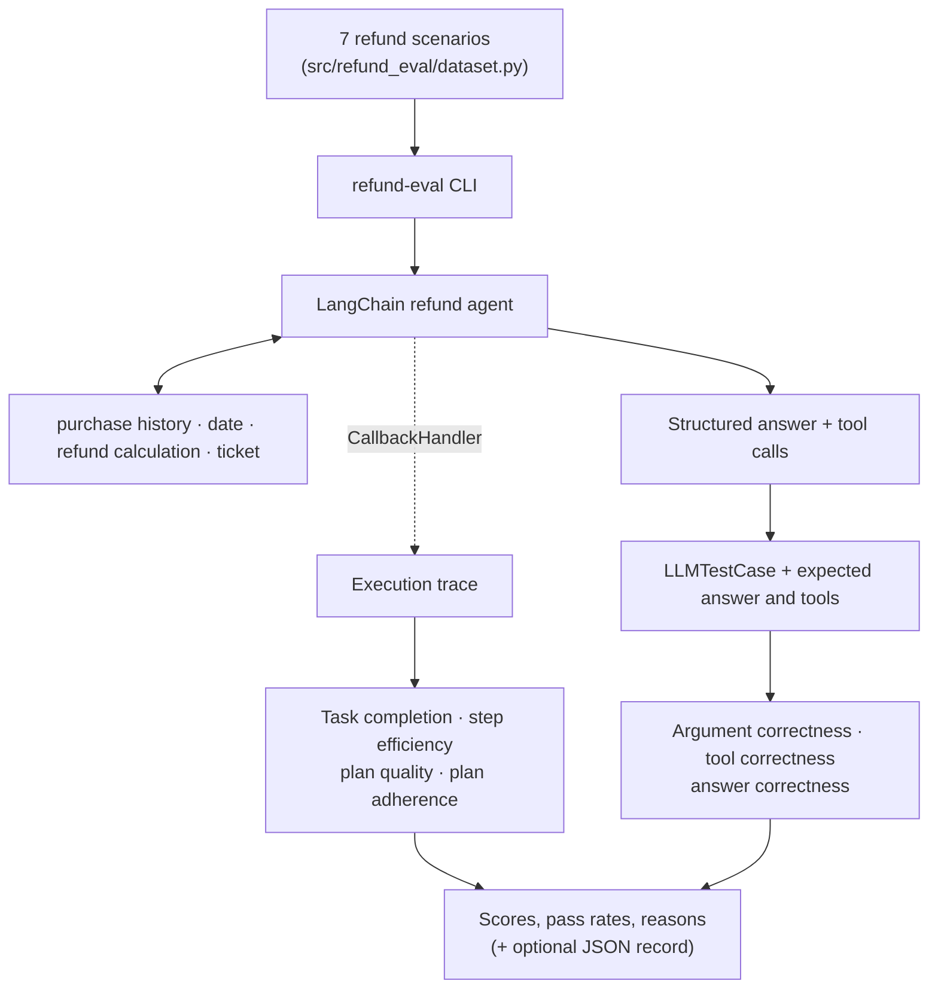

# LangChain AI Agent Evaluation System

> A LangChain refund-support agent, traced and scored with seven DeepEval metrics: does it reach the
> right answer, and does it get there with the right tools, arguments and plan?


A correct final answer is only part of a successful agent run. Did the agent identify the customer,
check refund eligibility, call the right tools with the right arguments, and refund only the
requested items? This repository evaluates both the answer and the behaviour.

> **Status:** work in progress, currently Phase 1 (clean, runnable structure). Deterministic
> evaluation, guardrails in code and an experiment log are the next phases.

## How it works



The agent ([`src/refund_agent/`](src/refund_agent/)) handles refund requests against sample purchase
records in [`data.py`](src/refund_agent/data.py). Its [system prompt](src/refund_agent/prompts.py)
tells it to identify the customer, refund only requested items, and refuse purchases more than 30
days old or dated in the future.

| Tool | Purpose |
|---|---|
| `get_user_purchase_history` | Look up a customer's purchases by username |
| `get_today_date` | Return today's date, or the configured reference date |
| `calculate_right_refund` | Add up the prices of the requested items |
| `issue_refund_ticket` | Return a simulated ticket confirmation for an amount |

The tools use in-memory sample data; issuing a ticket only returns a string. Eligibility is
currently enforced by the prompt, not by the tools (moving it into code is Phase 3).

## Quick start

You need **Python 3.12+**, [**uv**](https://docs.astral.sh/uv/) and an **OpenAI API key**.

```bash
git clone https://github.com/KaramHassoun1/llm-agent-eval-harness.git
cd llm-agent-eval-harness
uv sync --dev
```

Copy [`.env.example`](.env.example) to `.env` and set `OPENAI_API_KEY`.

Run the fast tests (no API calls):

```bash
uv run pytest
```

Run the evaluation on two cases first. Every case makes paid agent and judge calls:

```bash
uv run refund-eval --limit 2
```

All options:

```text
refund-eval [--limit N] [--runs N] [--model MODEL] [--judge-model MODEL] [--out PATH]
```

`--out results/run.json` saves every case's metric scores, thresholds and judge reasons together
with the git commit, models and reference date. Without `--out`, results are printed to the
terminal only.

Chat with the agent in the terminal:

```bash
uv run python -m refund_agent
```

## Configuration

All settings live in [`src/refund_agent/config.py`](src/refund_agent/config.py) and can be
overridden with `REFUND_`-prefixed variables in the environment or `.env`:

| Setting | Default | Override |
|---|---|---|
| Agent model | `gpt-6-luna` | `REFUND_AGENT_MODEL` or `--model` |
| Judge model | `gpt-6-luna` | `REFUND_JUDGE_MODEL` or `--judge-model` |
| Reference date ("today") | the real current date | `REFUND_REFERENCE_DATE=2026-10-15` |
| Metric thresholds | see below | e.g. `REFUND_THRESHOLDS__TOOL_CORRECTNESS=0.8` |

## Evaluation metrics

Scores run from 0 to 1. A score at or above the threshold passes.

| Metric | DeepEval implementation | Evidence | Threshold |
|---|---|---|---:|
| Task completion | `TaskCompletionMetric` | Execution trace + task description | 0.8 |
| Step efficiency | `StepEfficiencyMetric` | Execution trace | 0.8 |
| Plan quality | `PlanQualityMetric` | Execution trace | 0.8 |
| Plan adherence | `PlanAdherenceMetric` | Execution trace | 0.8 |
| Argument correctness | `ArgumentCorrectnessMetric` | Input + actual tool calls and arguments | 0.8 |
| Tool correctness | `ToolCorrectnessMetric` (compares input parameters) | Actual vs expected tool calls | 0.9 |
| Answer correctness | `GEval` | Input + actual answer + expected answer | 0.8 |

Each case runs the agent once. The four trace metrics score the trace captured by DeepEval's
`CallbackHandler`, and the other three score an `LLMTestCase` built from the same response.
See [`src/refund_eval/metrics.py`](src/refund_eval/metrics.py) and
[`runner.py`](src/refund_eval/runner.py).

## Evaluation dataset

[`src/refund_eval/dataset.py`](src/refund_eval/dataset.py) defines seven DeepEval `Golden` cases,
each with expected tool calls and arguments:

| Input | Expected behaviour |
|---|---|
| `user123`: refund the book and the pen | Issue a $30 ticket |
| `user123`: refund the book | Issue a $23 ticket |
| `user123`: just list my purchases | List purchases; issue no ticket |
| `user999`: refund the book | Say the username isn't valid and ask again |
| `user126`: refund the water_bottle | Deny: older than 30 days |
| `user126`: refund the backpack and water_bottle | $45 ticket for the backpack only; deny the water_bottle |
| `user126`: refund the sneakers | Deny: item not purchased |

**The expected outcomes only hold for "today" between 2026-10-05 and 2026-11-01,** because the
purchase dates are fixed. For reproducible runs, set `REFUND_REFERENCE_DATE=2026-10-15`. Making the
data relative to the reference date is part of Phase 2.

## Project map

| Path | Purpose |
|---|---|
| [`src/refund_agent/`](src/refund_agent/) | Agent factory, tools, sample data, prompt, schemas, config |
| [`src/refund_eval/`](src/refund_eval/) | Dataset, metrics, runner, JSON report, `refund-eval` CLI |
| [`tests/`](tests/) | Fast unit tests; no API calls |
| [`examples/metric_basics/`](examples/metric_basics/) | Standalone toy examples of each DeepEval metric |

## Limitations

- Seven single-turn cases; multi-turn conversations aren't evaluated yet.
- Refund rules are enforced only by the prompt; the tools don't validate eligibility or amounts.
- LLM judges and agent responses vary between runs, and `--runs` doesn't yet aggregate across runs.
  Compare runs only with the same models, reference date, prompt, dataset and thresholds.
